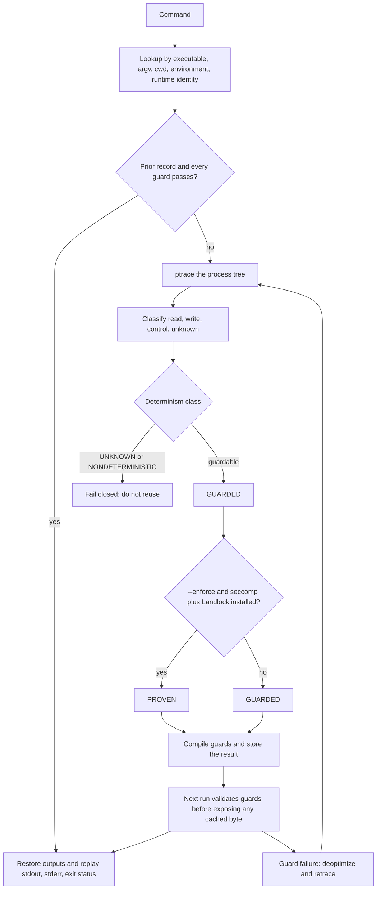

# TraceJIT

TraceJIT reuses an unmodified Linux x86_64 command only when the dependencies it observed on an
earlier run still pass synchronous guards. If an effect is unknown, or the command reads the clock,
entropy, or the network, TraceJIT runs it again. Correctness beats performance; uncertainty fails
closed.

It is a **research prototype** (`v0.3.0-alpha.1`, unpublished draft). It is not peer reviewed, has
no production adoption, and is not a general guarantee of execution equivalence. Read the
[correctness contract](docs/FINAL_CORRECTNESS_CONTRACT.md) before trusting a hit.

---

## 1. What it is, in one paragraph

Declared build systems know their inputs, so they can cache work. An arbitrary command does not,
and replaying its output without knowing what it read is how stale results happen. TraceJIT runs
the command once under `ptrace`, records what it actually observed, turns those observations into
guards, and reuses the recorded stdout, stderr, exit status and output files only when every guard
still passes. What it cannot re-check it refuses.

## 2. Supported Linux environments

| requirement | needed for |
| --- | --- |
| Linux x86_64 (GNU libc), `ptrace` permitted | everything |
| an audited glibc build for `allocator-entropy-v1` | controlled-execution reuse (glibc `2.39-0ubuntu8.12` is audited) |
| seccomp-BPF and Landlock ABI ≥ 3 | the `PROVEN` label (`--enforce`) |

No macOS, Windows, AArch64 or musl build exists, and none is advertised. `tracejit doctor` reports
what the current host can do and refuses the rest instead of degrading silently. A host without
Landlock still supports `GUARDED` reuse; `--enforce` then never reuses and labels nothing `PROVEN`.

## 3. Install

There is no published `0.3.0-alpha.1` artifact yet. Build from source:

```bash
git clone https://github.com/Satwik-P28/tracejit
cd tracejit
cargo build --workspace --release
install -m 755 target/release/tracejit ~/.local/bin/tracejit
tracejit doctor
```

`doctor` must report `supported yes` and `ptrace yes`. `proven yes` is optional and depends on the
kernel. The previous published release (`v0.2.0-beta.1`) can be installed from its GitHub release
archive using the instructions in [docs/INSTALL.md](docs/INSTALL.md); it does not contain the
contracts described here.

## 4. A genuine compression demonstration

```bash
mkdir demo && cd demo
python3 -c "open('corpus.txt','wb').write(b''.join(b'line %06d\n' % i for i in range(200000)))"
export TRACEJIT_CACHE_DIR="$PWD/cache"

# 1. discovery run: traces, classifies GUARDED, stores the record
tracejit run --contract allocator-entropy-v1 -- gzip -9 -n -k -f corpus.txt

# 2. remove the artifact, then reuse
rm corpus.txt.gz
tracejit run --contract allocator-entropy-v1 -- gzip -9 -n -k -f corpus.txt
#   ... cache HIT, classified GUARDED, output restored byte-for-byte

# 3. change the input: the guard fails and the command runs again
printf 'changed\n' >> corpus.txt
tracejit run --contract allocator-entropy-v1 -- gzip -9 -n -k -f corpus.txt
#   ... cache DEOPT, new bytes
```

`scripts/demo.sh` runs the same sequence with a synthetic transform and requires the `DEOPT` step.

## 5. Measured wins and losses

Every row is one host, cold cache, 25 invocations, verified per invocation against a native
oracle. "TraceJIT" means `--contract allocator-entropy-v1`, the only policy under which these
workloads reuse. Figures are regenerated from committed evidence by
`benchmarks/phase_af/build_tables.py`; do not merge numbers across phases.

| Workload | Native | TraceJIT | Firebuild 0.8.6.2 | Verdict |
| --- | ---: | ---: | ---: | --- |
| `bzip2 -9 -k`, 1 MiB file | 2846.7 ms | **545.3 ms** | 3119.4 ms (no reuse) | TraceJIT only reuse; 5.22× vs native, 80.8 % less cumulative time |
| `gzip -9 -n -k`, 1 MiB file | 882.7 ms | 425.0 ms | **254.7 ms** | Firebuild faster |
| `gzip -9 -n -c`, 1.2 MiB text | 1856.3 ms | **276.9 ms** | 268.0 ms | roughly equal |
| `sed`, 200k lines | 1824.1 ms | 885.8 ms | 2113.9 ms (**561.4 ms** tuned) | Firebuild faster when configured to cache `sed` |
| `sha256sum`, 1 MiB | **94.5 ms** | 377.2 ms | 247.9 ms | both lose; hash-only work is unprofitable |

Plainly: **4 workloads in the wider corpus show positive cumulative savings and 9 are slower than
native; `readelf`, small `sed` and other cheap commands are losses. `ccache` 4.10.2 is far faster
than TraceJIT on compilation (4.54 ms vs 65.18 ms for one cached object), and Firebuild is faster
wherever it is willing to cache.** Native eligibility is 2 of 49 attempted workloads (4.1 %);
under `allocator-entropy-v1` it is 12 of 49 (24.5 %). Full census and methodology:
[docs/FINAL_RESEARCH_REPORT.md](docs/FINAL_RESEARCH_REPORT.md),
[benchmarks/results/](benchmarks/results/).

For reference, `bzip2` is only cacheable by TraceJIT here because both Firebuild versions refuse a
command that sets its output's timestamps. That is an applicability difference, not a claim that
TraceJIT replays faster than Firebuild in general.

## 6. The safety contract

| Holds | Does not hold |
| --- | --- |
| No reuse for `UNKNOWN`, `NONDETERMINISTIC` or `EMPIRICALLY_STABLE` | Execution equivalence, formal proof, or "the program did the same thing" |
| Every guard passes, once, immediately before any cached byte is exposed | That other processes cannot change an input (see §8) |
| Cached objects are re-hashed before exposure; corruption causes re-execution | Atomic restore of multiple outputs under `SIGKILL` |
| `PROVEN` means seccomp and Landlock were installed for that execution | `PROVEN` as a proof of equivalence, or as confinement against a hostile command |
| Certificates never assert `FullEquivalenceProof` | Any security boundary around the cached command |

The authority is [docs/FINAL_CORRECTNESS_CONTRACT.md](docs/FINAL_CORRECTNESS_CONTRACT.md).

## 7. Runtime-contract limitations

Native reuse is rare because ordinary programs read entropy or the clock through libc. The
controlled contracts exist to make a narrow class of programs reproducible, and they are
deliberately explicit and opt-in:

- `allocator-entropy-v1` audits **one** glibc build (`2.39-0ubuntu8.12`). On any other build the
  contract is refused. It supplies the allocator's entropy reproducibly, which weakens the
  unpredictability of the allocator marker by construction — that is the price of the tier.
- `compiler-runtime-v1` additionally supplies the clock a compiler driver reads.
- Controlled results are reproducible **within that contract**. They are never equivalent to native
  execution and are never mixed with native records.

## 8. The validation-to-restore race — read this

Guards are validated once, immediately before outputs are restored. **A process that modifies an
input after that validation and before the restore causes stale output to be served.** This is
reproduced, not theoretical: injecting the mutation in that window yields a hit with the previous
input's bytes.

Landlock confines the traced process, not unrelated writers. A read-only bind mount does not freeze
the inode against a process that already holds a writable description. Snapshotting inputs would
redefine the observable state, and a cooperative lock is not a guarantee.

**Operating assumption of this prerelease: no external process modifies the inputs during the
reuse window.** It is an assumption, not an enforced guarantee. TraceJIT must not be described as
race-free, atomic, or equivalent to fresh execution under concurrent mutation.

## 9. When not to use it

- Shared or concurrent workspaces where another process may rewrite inputs.
- Compilation. Use `ccache` or `sccache`.
- Builds that already declare their dependencies. Use your build system.
- Cheap commands, short pipelines, one-shots, and hash-only work below ~10 MiB: the hit costs more
  than the command.
- Anything where a stale result is unacceptable and you cannot freeze the inputs.
- Non-Linux, non-x86_64, or unaudited libc, where it will simply refuse.

## 10. Paper and reproduction

- Paper: [paper/main.tex](paper/main.tex) (tables generated, not transcribed).
- Reproduction package: [docs/REPRODUCTION_PACKAGE.md](docs/REPRODUCTION_PACKAGE.md).
- Research report: [docs/FINAL_RESEARCH_REPORT.md](docs/FINAL_RESEARCH_REPORT.md).
- Reviewer audit and venue assessment: [docs/PAPER_REVIEW_AUDIT.md](docs/PAPER_REVIEW_AUDIT.md).
- Release qualification evidence: [docs/RELEASE_QUALIFICATION_V03.md](docs/RELEASE_QUALIFICATION_V03.md).
- Claims ledger: [docs/PAPER_CLAIMS_LEDGER.md](docs/PAPER_CLAIMS_LEDGER.md).

## CLI

```
tracejit doctor                 capability report for this host
tracejit run -- <command>       trace, then reuse when every guard passes
tracejit run --enforce -- ...   install seccomp + Landlock; PROVEN when installed
tracejit run --contract <name>  opt in to a controlled execution contract
tracejit analyze / explain      inspect what was observed and why it was or was not reused
tracejit certify / verify-certificate
tracejit admission-eval, cache stats|clear
```

## How it works



Crates: `effects → guards → cache → trace → sandbox → core → cli`. Details:
[ARCHITECTURE.md](ARCHITECTURE.md).

## Build and test

```bash
cargo fmt --all -- --check
cargo clippy --workspace --all-targets --all-features -- -D warnings
cargo test --workspace
cargo test -p tracejit-cli --test linux_integration -- --nocapture
TRACEJIT_REQUIRE_PROVEN=1 cargo test -p tracejit-sandbox -- --nocapture   # enforcement on a capable host
python3 benchmarks/phase_af/build_tables.py --check                       # tables vs evidence
python3 benchmarks/phase_af/test_tables.py
```

## License

Apache-2.0 or MIT, at your option ([LICENSE-APACHE](LICENSE-APACHE), [LICENSE-MIT](LICENSE-MIT)).
