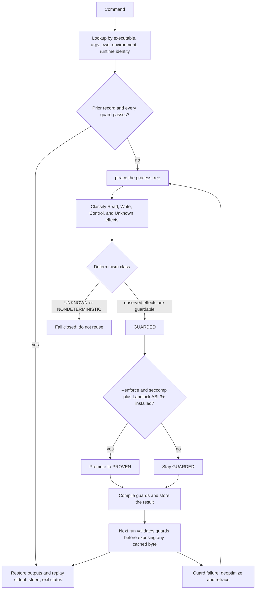

# TraceJIT

Reuse an unmodified Linux x86_64 command only when the dependencies TraceJIT observed still pass synchronous guards. If an effect is unknown, or the command reads the clock, randomness, or the network, TraceJIT runs it again. Correctness beats performance; uncertainty fails closed.

## Why this is hard

Declared build graphs (Make, Ninja, Bazel) and compiler caches (ccache, sccache) reuse work when inputs are listed or toolchain-specific. An already-built command does not come with that list. Replaying stdout and output files without checking what the process actually depended on is a stale-hit hazard. ptrace sees modeled kernel crossings, not arbitrary userspace influence; clocks, entropy, process identity, and unmodeled syscalls force refusal rather than a guessed hit.

## What it supports now

- Linux x86_64 whole-command memoization via ptrace, BLAKE3 CAS, and SQLite.
- Reuse only for `GUARDED` and `PROVEN` records after every guard passes.
- Optional `--enforce` (seccomp + Landlock ABI 3+) for `PROVEN`.
- Bounded alternate candidates per identity (default 8), A/B/A reuse, stream verify before output mutation.
- CLI: `run`, `analyze`, `explain`, `doctor`, `certify` / `verify-certificate`, `admission-eval`, cache stats/clear.
- Strict hashing by default; `--guard-mode fast` is an explicit opt-in.

Not supported: macOS/Windows/non-x86_64 reuse, partial in-process reuse, remote caches, peer-reviewed or production-adoption claims.

## Central contribution

Fail-closed **effect-aware whole-process memoization**: observe → classify → compile guards → reuse only when eligibility and guards hold, with testable refusals and an explicit Obs contract ([docs/research/EXECUTION_EQUIVALENCE.md](docs/research/EXECUTION_EQUIVALENCE.md)). Related systems already cache processes or builds; TraceJIT’s assessed contribution is this combination of classification, guards, certificates, refinement workflow, and measured negatives—not a claim of novelty for caching itself.

## Guarantees that actually hold

| Holds | Does not hold |
| --- | --- |
| No reuse for `UNKNOWN` / `NONDETERMINISTIC` / `EMPIRICALLY_STABLE` | Full execution equivalence or formal proof |
| Guards + stream verify before exposing cached bytes | Freeze of other processes (validate→restore TOCTOU remains) |
| `PROVEN` means seccomp and Landlock were installed | `PROVEN` as machine-checked Obs proof |
| Certificates never grant `FullEquivalenceProof` | Crash-atomic multi-output restore under hard kill |

Feature status table: [docs/research/CLAIMS_LEDGER.md](docs/research/CLAIMS_LEDGER.md). Safety narrative: [SAFETY.md](SAFETY.md).

## Measured wins and losses

All figures cite committed harness outputs. Tip for Phase G evidence: merge `b089d5e` (PR #16).

**Wins (Phase G session A medians, `benchmarks/results/phase_g/evaluation-session-a.md`):**

| Scenario | Result |
| --- | --- |
| CPU-heavy `c-transform` | 36.136 → **3.116** ms warm reused (~11.6×) |
| `bzip2 -9` (contract) | 26.485 → **5.333** ms |
| A/B/A third invocation | **4/4** Reused |
| mtime-preserved edit / corrupt output | TraceJIT **correct**; make **incorrect** |

**Losses retained:**

| Scenario | Result | Evidence |
| --- | --- | --- |
| Official short C ETL | 1.455 → 3.571 ms (**0.407×**) | `benchmarks/results/latest.md` @ `94c64c7` |
| Large ~8 MiB read | 10.786 → 21.539 ms | Phase G session A |
| Identical build rerun vs make | TraceJIT slower; may deopt on output presence | Phase G |

Historical hosted-runner transform **78.780×** (`e9684c1`) and short-ETL **0.929×** (`63e3363`) remain historical; do not merge them into a same-commit comparison. ninja/ccache/sccache were **not installed** on the Phase G host and are not claimed.

## Demo

Linux x86_64:

```bash
cargo build --workspace --release
./scripts/demo.sh
./target/release/tracejit doctor
```

`demo.sh` compiles the synthetic transform, traces, reuses, explains, mutates the input, and requires `DEOPT`. For the short-command harness:

```bash
./scripts/benchmark.sh
```

## Technical report and application notes

- Design/evidence report (Part XVIII structure): [docs/research/TRACEJIT_TECHNICAL_REPORT.md](docs/research/TRACEJIT_TECHNICAL_REPORT.md)
- Claims ledger: [docs/research/CLAIMS_LEDGER.md](docs/research/CLAIMS_LEDGER.md)
- FOCUS / application materials: [docs/focus/APPLICATION_MATERIALS.md](docs/focus/APPLICATION_MATERIALS.md)

## 30-second path

```text
tracejit doctor
tracejit run -- <command> [args...]
tracejit run -- <command> [args...]
tracejit explain
```

The first `run` traces. The second reuses only when the class is `GUARDED` or `PROVEN` and every guard passes.

## How it works



## Architecture and tests

Crates: `effects → guards → cache → trace → sandbox → core → cli`. Details: [ARCHITECTURE.md](ARCHITECTURE.md).

```bash
cargo fmt --all -- --check
cargo clippy --workspace --all-targets --all-features -- -D warnings
cargo test --workspace
cargo test -p tracejit-cli --test linux_integration -- --nocapture
```

Adversarial fixture narrative: [docs/ADVERSARIAL.md](docs/ADVERSARIAL.md). Comparisons: [docs/COMPARISONS.md](docs/COMPARISONS.md).

## License

Apache-2.0 or MIT, at your option ([LICENSE-APACHE](LICENSE-APACHE), [LICENSE-MIT](LICENSE-MIT)).
