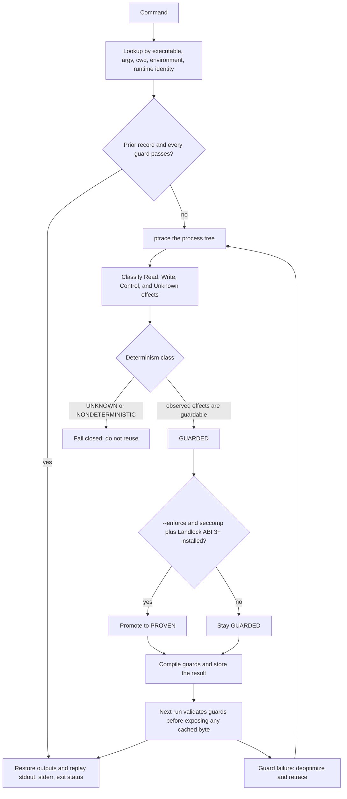

# TraceJIT

Reuse an unmodified Linux x86_64 command only when the dependencies TraceJIT observed still pass synchronous guards. If an effect is unknown, or the command reads the clock, randomness, or the network, TraceJIT runs it again. Correctness beats performance; uncertainty fails closed.

**Status:** `v0.2.0-beta.1` is the published beta. Current `main` is **unreleased** and contains behaviour the beta does not have (a second audited contract, `compiler-runtime-v1`, and the 8.12 allocator admission). It is a research-oriented prototype for Linux x86_64: not a general guarantee of execution equivalence, not peer reviewed, and with no production adoption. Read [known limitations](docs/LIMITATIONS.md) before trusting a hit.

## Install

Linux x86_64 only. The archive contains the binary, licenses, safety and security documentation, provenance manifest, and SBOM.

```bash
version=$(curl -fsSL https://raw.githubusercontent.com/Satwik-P28/tracejit/main/VERSION)
base="https://github.com/Satwik-P28/tracejit/releases/download/v${version}"
name="tracejit-v${version}-x86_64-unknown-linux-gnu.tar.gz"
curl -fsSLO "${base}/${name}" && curl -fsSLO "${base}/SHA256SUMS"
sha256sum -c --ignore-missing SHA256SUMS
tar -xzf "$name" && install -m 755 "tracejit-v${version}-x86_64-unknown-linux-gnu/tracejit" ~/.local/bin/tracejit
tracejit doctor   # requires supported yes and ptrace yes
```

Full instructions, source builds, and artifact verification: [docs/INSTALL.md](docs/INSTALL.md).

## Why this is hard

Declared build graphs (Make, Ninja, Bazel) and compiler caches (ccache, sccache) reuse work when inputs are listed or toolchain-specific. An already-built command does not come with that list. Replaying stdout and output files without checking what the process actually depended on is a stale-hit hazard. ptrace sees modeled kernel crossings, not arbitrary userspace influence; clocks, entropy, process identity, and unmodeled syscalls force refusal rather than a guessed hit.

## What it supports now

- Linux x86_64 whole-command memoization via ptrace, BLAKE3 CAS, and SQLite.
- Reuse only for `GUARDED` and `PROVEN` records after every guard passes.
- Optional `--enforce` (seccomp + Landlock ABI 3+) for `PROVEN`.
- Bounded alternate candidates per identity (default 8), A/B/A reuse, stream verify before output mutation.
- CLI: `run`, `analyze`, `explain`, `doctor`, `certify` / `verify-certificate`, `admission-eval`, cache stats/clear.
- Strict hashing by default; `--guard-mode fast` is an explicit opt-in.

Not supported: macOS/Windows/non-x86_64 reuse, partial in-process reuse, remote caches, peer-reviewed or production-adoption claims.

## Central contribution

Fail-closed **effect-aware whole-process memoization**: observe → classify → compile guards → reuse only when eligibility and guards hold, with testable refusals and an explicit Obs contract ([docs/research/EXECUTION_EQUIVALENCE.md](docs/research/EXECUTION_EQUIVALENCE.md)). Related systems already cache processes or builds; TraceJIT’s assessed contribution is this combination of classification, guards, certificates, refinement workflow, and measured negatives—not a claim of novelty for caching itself.

## Guarantees that actually hold

| Holds | Does not hold |
| --- | --- |
| No reuse for `UNKNOWN` / `NONDETERMINISTIC` / `EMPIRICALLY_STABLE` | Full execution equivalence or formal proof |
| Guards + stream verify before exposing cached bytes | Freeze of other processes (validate→restore TOCTOU remains) |
| `PROVEN` means seccomp and Landlock were installed | `PROVEN` as machine-checked Obs proof |
| Certificates never grant `FullEquivalenceProof` | Crash-atomic multi-output restore under hard kill |

Feature status table: [docs/research/CLAIMS_LEDGER.md](docs/research/CLAIMS_LEDGER.md). Safety narrative: [SAFETY.md](SAFETY.md).

## Measured wins and losses

All figures cite committed harness outputs with exact tips. Do not merge numbers across commits into one “speedup.” Three release states exist in this repository and their numbers are **not** interchangeable: the published beta (`v0.2.0-beta.1`, `7a594b9`), historical `main` before that tag (`4ffde9a`), and current unreleased `main`.

**Current `main`, real-world corpus (Phase AA)** — 59 workloads, 177 (tier × contract) rows, randomized paired samples with bootstrap intervals, host fingerprint in `benchmarks/results/phaseaa/environment.json`, protocol in [docs/REAL_WORLD_BENCHMARK_PROTOCOL.md](docs/REAL_WORLD_BENCHMARK_PROTOCOL.md):

| Tier / contract | Attempted | Reused | Rate |
| --- | ---: | ---: | ---: |
| A, native execution | 49 | 1 | 2.0 % |
| A, `allocator-entropy-v1` | 49 | 10 | 20.4 % |
| A, `compiler-runtime-v1` | 49 | 17 | 34.7 % |
| C, any contract (adapted workloads) | 5 | 0 | 0 % |

Measured rows only (13 workloads, warm-page-cache, direct vs warm HIT median):

| Workload | Direct | Warm HIT | Ratio (95 % CI) | Break-even | Session at 25× |
| --- | ---: | ---: | ---: | ---: | ---: |
| `c-numeric-integration` | 344.9 ms | **11.4 ms** | 30.6× (24.1–39.5) | 1 | 13.1× |
| `gcc-cc-heavy-tu` (zlib `deflate.c -O2`) | 610.1 ms | **86.4 ms** | 7.4× (5.3–9.3) | 1 | 5.3× |
| `zlib-compile-deflate` | 611.5 ms | **83.1 ms** | 6.9× (5.3–8.8) | 1 | 5.4× |
| `zlib-compile-adler32` | 99.8 ms | 78.4 ms | 1.32× (1.17–1.44) | 12 | 1.12× |
| `gcc-noopt-compile` | 73.3 ms | 71.0 ms | 1.02× (0.87–1.17) | 128 | 0.89× |
| `sed-substitute-file` | 14.0 ms | 79.9 ms | 0.17× | — | 0.17× |
| `readelf-header` | 2.5 ms | 16.1 ms | 0.15× | — | 0.15× |

Aggregate, stated plainly: **4 workloads with positive cumulative savings, 8 slower than native, 0 incorrect HITs.** The cheapest warm hit measured on this host was 11.4 ms and a small command's floor is 13–17 ms, so every command cheaper than that loses. `make`, CPython, Node and `perl` workloads are refused and stay in the tables as negative results.

**Historical pre-beta `main`** (measured `4ffde9a`, product `crates/` ≡ `ed3bd39`/`7b9e7ca`; `benchmarks/results/final_stab_pr3/mandate_s4/`, n=30, bootstrap 95% CI). These are **not** beta or current-`main` numbers; the `c-transform` row is a synthetic 250 M-round busy loop, not a real workload:

| Scenario | DIRECT | Warm HIT | Note |
| --- | ---: | ---: | --- |
| Synthetic CPU-bound `c-transform` | 32.524 ms | 5.303 ms (~6.1×) | Synthetic; no safe warm-HIT opt landed |
| `/bin/true` / short floor | **0.351 ms** | 4.475 ms | Warm **loss** — DIRECT wins |
| Short-ETL session cumulative | **35 ms** | 177 ms | HITs can still lose the session |

**Beta release candidate `v0.2.0-beta.1`** (measured `cdb307b`, n=20, bootstrap 95% CI, `benchmarks/releases/v0.2.0-beta.1/`):

| Scenario | DIRECT | Cold trace | Warm HIT | Note |
| --- | ---: | ---: | ---: | --- |
| CPU-heavy `c-transform` | 333.1 ms | 374.6 ms | **8.8 ms** | About 37× on this host |
| `/bin/true` | **0.83 ms** | — | 6.41 ms | Warm loss |
| `gzip -9` over 4 MiB | **117.2 ms** | 428.1 ms | 289.3 ms | Warm loss: replaying compressed stdout |
| 10-run ETL session | **89.0 ms** | — | 125.3 ms | Session loss despite correct hits |
| 64 MiB output file | **142.8 ms** | 588.9 ms | 193.3 ms | Restore and fsync dominate |
| 8 concurrent `/bin/true` | — | 72.4 ms | 22.1 ms | All processes correct |

**Beta census:** 1/32 eligibility under unmodified defaults (`mandate_s4/census/`; the beta census reproduces 1/32 in `benchmarks/releases/v0.2.0-beta.1/census/`). That single number is a beta-era figure and mixed contract rows into the same sentence; the Phase AA table above replaces it with one cell per (tier, contract).

**Withdrawn opt:** destination-match restore skip — synthetic back-to-back looked faster; with output consumption skip rate is **0/40**. Not a product claim ([final_stab_pr3/compare.md](benchmarks/results/final_stab_pr3/compare.md)).

**Competitive (tip `364331b`, `benchmarks/results/phase_k8/`):** Make/Ninja win identical-rerun wall time; TraceJIT stays content-correct on mtime-preserved edit / corrupt output where Make/Ninja returned WRONG. Missing tools are skipped, not scored as losses.

Release report: [docs/final/RELEASE_REPORT.md](docs/final/RELEASE_REPORT.md). Older adversarial packaging: [docs/final/FINAL_ANSWER.md](docs/final/FINAL_ANSWER.md).

Phase AA evidence: [docs/PHASE_AA_REPORT.md](docs/PHASE_AA_REPORT.md) · [benchmark coverage matrix](docs/BENCHMARK_COVERAGE_MATRIX.md) · [competitive evaluation](docs/COMPETITIVE_EVALUATION.md) · [release readiness](docs/RELEASE_READINESS_V03.md) · [hypothesis ledger](docs/PHASE_AA_LEDGER.md).

## Demo

Linux x86_64:

```bash
cargo build --workspace --release
./scripts/demo.sh
./target/release/tracejit doctor
```

`demo.sh` compiles the synthetic transform, traces, reuses, explains, mutates the input, and requires `DEOPT`. It runs with `TRACEJIT` set to an installed binary as well:

```bash
TRACEJIT=~/.local/bin/tracejit ./scripts/demo.sh
```

For the short-command harness and the release benchmark package:

```bash
./scripts/benchmark.sh
python3 benchmarks/releases/run_release.py --runs 20 --warmups 3
./benchmarks/realworld_v2/run.sh        # Phase AA real-world corpus, all tiers
AA_MODE=smoke ./benchmarks/realworld_v2/run.sh
```

Release evidence lives in `benchmarks/releases/v<version>/`; the methodology is in [docs/BENCHMARK_REPRODUCTION.md](docs/BENCHMARK_REPRODUCTION.md).

## Technical report and application notes

- Final adversarial package index: [docs/final/FINAL_ANSWER.md](docs/final/FINAL_ANSWER.md) · [EXECUTIVE_SUMMARY.md](docs/final/EXECUTIVE_SUMMARY.md) · [ARTIFACT_EVALUATION.md](docs/final/ARTIFACT_EVALUATION.md)
- Design/evidence report: [docs/research/TRACEJIT_TECHNICAL_REPORT.md](docs/research/TRACEJIT_TECHNICAL_REPORT.md)
- Claims ledger: [docs/research/CLAIMS_LEDGER.md](docs/research/CLAIMS_LEDGER.md)
- Prior-art matrix: [docs/final/PRIOR_ART_IMPLEMENTATION_MATRIX.md](docs/final/PRIOR_ART_IMPLEMENTATION_MATRIX.md)
- FOCUS / application materials: [docs/focus/APPLICATION_MATERIALS.md](docs/focus/APPLICATION_MATERIALS.md)

## 30-second path

```text
tracejit doctor
tracejit run -- <command> [args...]
tracejit run -- <command> [args...]
tracejit explain
```

The first `run` traces. The second reuses only when the class is `GUARDED` or `PROVEN` and every guard passes.

## How it works



## Supported platforms

Linux x86_64 (GNU) with `ptrace` permitted. `doctor` refuses other operating systems, architectures, and missing kernel features instead of degrading silently. There is no macOS, Windows, AArch64, or musl build; none is advertised.

## Architecture and tests

Crates: `effects → guards → cache → trace → sandbox → core → cli`. Details: [ARCHITECTURE.md](ARCHITECTURE.md).

```bash
cargo fmt --all -- --check
cargo clippy --workspace --all-targets --all-features -- -D warnings
cargo test --workspace
cargo test -p tracejit-cli --test linux_integration -- --nocapture
```

Adversarial fixture narrative: [docs/ADVERSARIAL.md](docs/ADVERSARIAL.md). Comparisons: [docs/COMPARISONS.md](docs/COMPARISONS.md).

## License

Apache-2.0 or MIT, at your option ([LICENSE-APACHE](LICENSE-APACHE), [LICENSE-MIT](LICENSE-MIT)).
